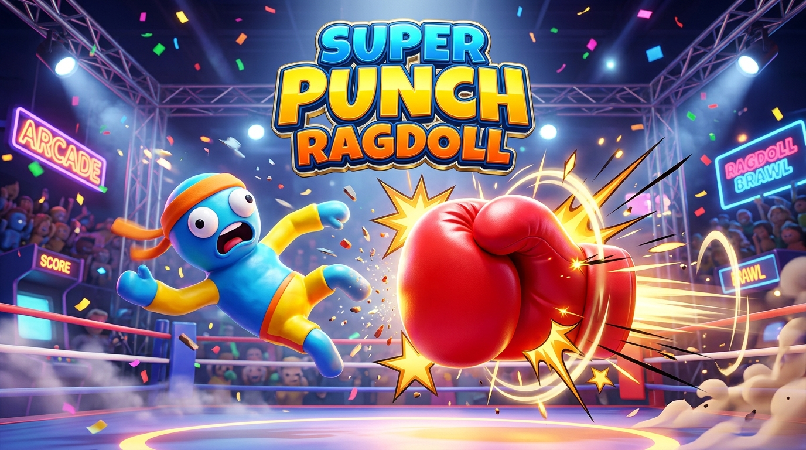

# 🥊 Super Punch Ragdoll

<div align="center">



**A high-energy, 3D physics-based ragdoll punching arcade game built with Babylon.js and Havok Physics WASM.**

[](https://www.babylonjs.com/)
[](https://www.havok.com/)
[](https://www.typescriptlang.org/)
[](https://vitejs.dev/)
[](https://support.google.com/youtube/answer/13831872)
[](LICENSE)

[🎮 Features](#-key-features) • [🚀 Getting Started](#-getting-started) • [🕹️ Controls & Gameplay](#️-controls--gameplay) • [🏗️ Architecture](#️-project-architecture) • [🛠️ Level Editor](#️-built-in-level-editor)

</div>

---

## 🌟 Overview

**Super Punch Ragdoll** is a fast-paced hyper-casual 3D action game where players aim, charge, and unleash explosive spring-loaded punches to blast ragdoll characters through chaotic, obstacle-filled arenas. Featuring real-time WASM physics calculations, custom impact shockwaves, and comic-style VFX, every punch delivers satisfying tactile feedback.

---

## ✨ Key Features

- **⚡ High-Fidelity Havok Physics (WASM)**: Realistic multi-joint ragdoll skeleton simulation, dynamic joint stiffness, and impulse reaction powered by `@babylonjs/havok`.
- **🎯 Continuous Collision Detection (CCD)**: Custom slab-method AABB line-segment intersection algorithms preventing high-velocity punches from clipping or tunneling through obstacles.
- **📺 YouTube Playables Ready**: Production-grade integration with YouTube Playables SDK v1 (`firstFrameReady`, audio pause/resume sync, cloud save state, responsive aspect ratio).
- **🛠️ Integrated Runtime Level Editor**: Built-in 3D level editor with real-time translation gizmos, prop placement, obstacle chaining, and JSON level import/export.
- **🔊 Procedural & Dynamic Audio Engine**: Web Audio API-powered dynamic sound design featuring punch whooshes, comic impact sounds, coin pickups, and victory fanfares.
- **🌐 Multi-Language Localization (i18n)**: Native multi-language modal supporting English, Hindi, Spanish, French, German, and more.
- **📱 Responsive & Cross-Platform**: Flawless cross-device support for desktop mouse controls and mobile touch gestures with dynamic viewport scaling.
- **🎨 Custom Character Styling & Props**: Dynamic character faces, customizable skins, floating coin collectibles, and interactive destructible props.

---

## 🕹️ Controls & Gameplay

| Device | Action | Description |
|---|---|---|
| **Desktop** | **Click & Drag** | Aim the punch trajectory and spring tension |
| **Desktop** | **Release** | Fire the punch glove towards the ragdoll target |
| **Mobile** | **Touch & Drag** | Drag on canvas to visualize arc and trajectory |
| **Mobile** | **Release** | Release finger to launch the super punch |
| **Universal**| **Sound Toggle** | Tap the speaker icon in top HUD to toggle mute |
| **Universal**| **Level Selector** | Select unlocked levels or replay challenges |

---

## 🚀 Getting Started

### Prerequisites

Ensure you have the following installed:
- [Node.js](https://nodejs.org/) (v18.0.0 or higher recommended)
- [npm](https://www.npmjs.com/) or [pnpm](https://pnpm.io/)

### Installation

1. Clone the repository:
   ```bash
   git clone https://github.com/satyamkumar420/super-punch-ragdoll.git
   cd super-punch-ragdoll
   ```

2. Install dependencies:
   ```bash
   npm install
   ```

3. Launch development server:
   ```bash
   npm run dev
   ```
   Open your browser at `http://localhost:5173` to test the game!

### Building for Production

Compile TypeScript and generate optimized production bundle:
```bash
npm run build
```

Preview production build locally:
```bash
npm run preview
```

---

## 🏗️ Project Architecture

```
super-punch-ragdoll/
├── config/                  # Level JSON data, themes, and configuration schemas
├── docs/                    # Documentation and media assets
│   └── assets/              # High-resolution banners and preview images
├── public/                  # Static assets (HavokPhysics.wasm, 3D glTF models, textures)
│   ├── assets/              # 3D models and sound samples
│   ├── HavokPhysics.wasm    # Havok WebAssembly physics engine binary
│   └── banner.jpg           # Game promotional artwork
├── src/
│   ├── config/              # Game configuration & level setups
│   ├── core/                # Collision managers, animations, gizmos, and responsive logic
│   ├── editor/              # In-game 3D Level Editor system
│   ├── environments/        # Skyboxes, arenas, lighting, and environmental effects
│   ├── i18n/                # Localization dictionaries and modal controllers
│   ├── services/            # YouTube Playables SDK & persistent storage handlers
│   ├── audio.ts             # Audio manager and Web Audio sound synthesizer
│   ├── character.ts         # Character mesh hierarchy & joint hierarchy
│   ├── characterFace.ts     # Procedural facial expressions & emotion states
│   ├── characterStyling.ts  # Material colors, textures, and customizations
│   ├── characterWeapon.ts   # Weapon attachments and obstacle interactions
│   ├── main.ts              # Game entry point, UI overlay wiring, and state machine
│   ├── physics.ts           # Babylon.js Havok physics plugin initialization
│   ├── props.ts             # Destructible crates, targets, and arena props
│   ├── punchShooter.ts      # Punch spring trajectory, aiming raycast, CCD math
│   ├── ragdoll.ts           # Joint ragdoll creation, impulse handling, comic hit effects
│   ├── scene.ts             # Scene creation, shadows, camera rigging, and rendering loop
│   └── style.css            # Responsive HUD overlay styles and UI animations
├── index.html               # Main HTML entry with canvas and UI overlay
├── package.json             # NPM dependencies and build scripts
├── tsconfig.json            # Strict TypeScript configuration
└── vite.config.ts           # Vite build pipeline and WASM serving setup
```

---

## 🛠️ Built-in Level Editor

Super Punch Ragdoll includes a runtime Level Editor for rapid gameplay prototyping:
- **Toggle Editor**: Press the Editor icon in the HUD (or use `?editor=true` query param).
- **Spawn Props**: Add obstacles, targets, walls, trampolines, and coin pickups.
- **Gizmo Transform**: Move and rotate objects directly in 3D viewport.
- **Export / Import**: Save custom levels as JSON configurations.

---

## 📄 License

This project is licensed under the [MIT License](LICENSE).

---

<div align="center">
Made with ❤️ by <a href="https://github.com/satyamkumar420">Satyam Kumar</a>
</div>
